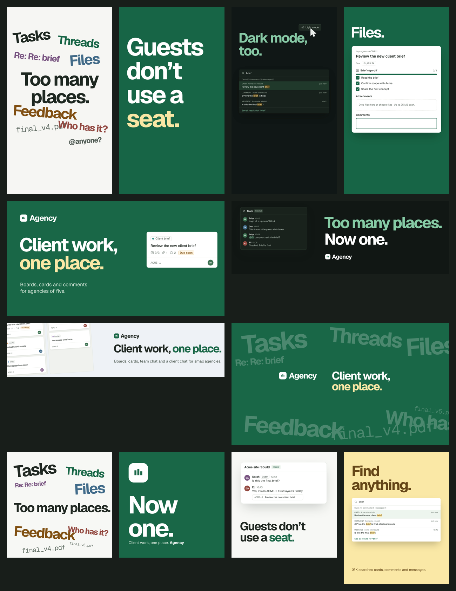

# Agency marketing kit



Everything here is built from this repository's own design system (`src/styles/tokens.css`, light and dark),
Geist, the product's components and its real copy. Claims trace to the codebase; see the fact sheet at the end
of [`COPY.md`](COPY.md). People, messages and card titles in visuals are illustrative.

The two long films live beside this folder: `../promo` (32 s, calm walkthrough) and `../promo-launch`
(30 s, kinetic launch film).

## What's here

| Asset | Files |
| --- | --- |
| Copy deck: positioning, tagline, 15 slogans, descriptions, feature lines, captions per video, ad copy, email, boilerplate, alt text, voice | [`COPY.md`](COPY.md) |
| Vertical shorts (1080 × 1920, 30 fps, ~12 s, music and sound) for Reels, Shorts and TikTok | [`videos/`](videos) |
| Banners for every major platform | [`banners/png/`](banners/png) |
| One-page sales sheet (A4) to send or print for clients | [`sales-sheet/agency-sales-sheet.pdf`](sales-sheet/agency-sales-sheet.pdf) |

### Shorts

| File | Hook | Story |
| --- | --- | --- |
| `too-many-places.mp4` | "Tasks" on frame 0 | Six words, one per beat, pile into "Too many places."; the mark; "One place for … everything."; claim; end card |
| `guests-dont-use-a-seat.mp4` | A client asks "Is this the final brief?" | Answer on the card; Team stays internal; clients see their board; "Guests don't use a seat."; "Invite the client, not the chaos." |
| `find-anything.mp4` | "Where's that file?" | ⌘ and K slam; search finds the card, comment and message; "Cards. Comments. Messages. One search."; Dark mode iris |
| `one-card.mp4` | "From brief to done." with the card | Checklists tick, a file drops, an @mention, "Due soon", the card moves To do → In progress → Done |

All four share the 128 BPM grid, the claim ("Client work, one place.") and the end card ("Start free trial").
Words and product UI stay between 168 and 1330 px, clear of the platforms' own buttons and captions.

### Banners

| File | Size | Use |
| --- | --- | --- |
| `og-image.png` | 1200 × 630 | Link previews (Open Graph, Facebook and LinkedIn shares) |
| `x-card.png` | 1200 × 675 | X / Twitter large card |
| `x-header.png` | 1500 × 500 | X profile header (words kept clear of the avatar) |
| `linkedin-cover.png` | 1584 × 396 | LinkedIn personal cover (lower left kept clear for the photo) |
| `linkedin-company-cover.png` | 2256 × 382 | LinkedIn company page cover (1128 × 191 at 2x) |
| `facebook-cover.png` | 1702 × 630 | Facebook page cover (851 × 315 at 2x) |
| `youtube-banner.png` | 2560 × 1440 | YouTube channel art; words inside the 1546 × 423 safe area |
| `instagram-1-too-many-places.png`, `-2-one-place.png`, `-3-guests.png` | 1080 × 1080 | Instagram carousel, in order |
| `instagram-portrait-find-anything.png`, `-team-stays-internal.png` | 1080 × 1350 | Instagram portrait posts |
| `story-client-work.png`, `story-start-free-trial.png` | 1080 × 1920 | Stories |
| `email-header.png` | 1200 × 400 | Email header |

## Rebuild

Needs Python 3 (numpy, scipy, Pillow), Node 22+, FFmpeg and a Chrome/Chromium binary.

```sh
cd marketing
npm install --prefix scripts puppeteer-core           # once, for banners and the sales sheet
python3 scripts/build_banners.py && CHROME_PATH=/path/to/chrome node scripts/render_banners.mjs
CHROME_PATH=/path/to/chrome node scripts/render_sales_sheet.mjs
python3 scripts/build_shorts.py                         # writes shorts/<name>/ and each soundtrack
cd shorts/too-many-places && npx hyperframes@0.8.185 render --quality delivery --output renders/too-many-places.mp4
../../scripts/finish_audio.sh renders/too-many-places.mp4 ../../videos/too-many-places.mp4
```

Edit the generators, not their output: `build_banners.py` (layouts and copy), `build_shorts.py` (every short's
scenes, timing and sound cues), `make_short_music.py` (soundtracks from each short's
`assets/music/arrangement.json`). Sound effects are from Pixabay (`assets/sfx/CREDITS.md`); Geist is under the
SIL Open Font License (`assets/fonts/OFL-geist.txt`).

## Not checked

The soundtracks are synthesised in code and were measured (loudness, peaks, beat alignment), not listened to.
A licensed 128 BPM track is the biggest upgrade. The feature crawl under each end card is deliberately faint
texture in the bottom zone the platforms cover, so `check` flags its contrast; it carries no information. Banner safe areas follow current platform guidance; check
crops in each platform's upload preview.
